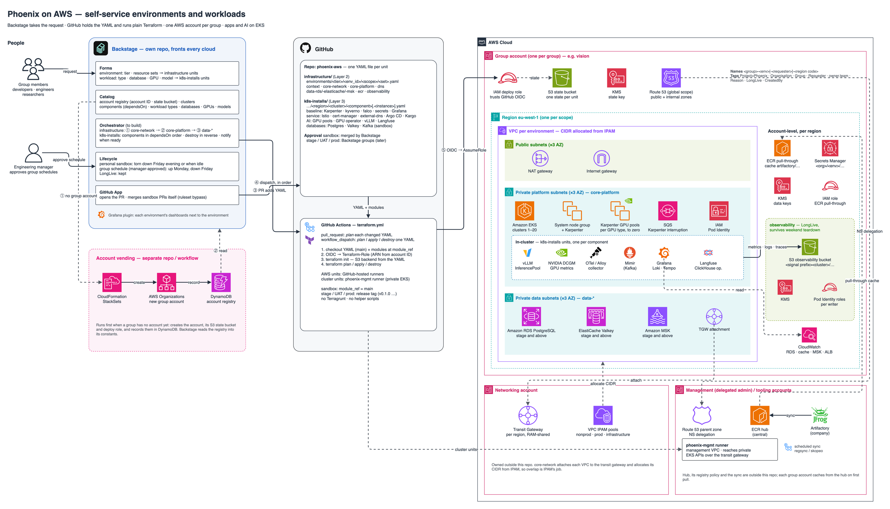

# Phoenix on AWS

Self-service infrastructure for normal applications and AI workloads. A
developer, engineer or researcher asks Backstage for what they need — an
environment, then a workload type, a database, a GPU, a model — and gets it:
Backstage writes one YAML file per unit into this repo, and one GitHub Actions
workflow runs plain Terraform for each, in order.



| Folder | What | |
|---|---|---|
| [`infrastructure/`](infrastructure/README.md) | Layer 2 — the AWS side of an environment: VPCs (IPAM), EKS, data services, DNS, observability storage, ECR pull-through | 9 resource sets |
| [`networking/`](networking/README.md) | Layer 1 — the platform network: IPAM, hubs and transit gateways, peering, hybrid | |
| [`phoenix-k8s`](https://github.com/Haykhay/phoenix-k8s) (separate repo) | Layer 3 — what runs inside each cluster: baseline, gateway, delivery, databases, GPUs, vLLM, Langfuse | its own workflow |
| Backstage (separate: it fronts every cloud in the series) | The front door: the environment and workload forms, the catalog of what's on offer, Entra sign-in (toggle) | runs locally in Docker |
| [`.github/workflows/terraform.yml`](.github/workflows/terraform.yml) | The pipeline for Layers 1 and 2 | |
| [`docs/adr/`](docs/adr/README.md) | The architecture decisions behind it, one record each | 10 ADRs |

## How a request flows

1. **Environment form** → `infrastructure/environments/<tier>/<env_id>/<scope>/<resource-set>.yaml`
   (network, cluster, DNS, data services) and a cluster entity for the catalog.
2. **Workload form** → `environments/<tier>/<env_id>/<region>/<cluster>/<component>[.<instance>].yaml`
   in [`phoenix-k8s`](https://github.com/Haykhay/phoenix-k8s), one per
   component the chosen options need. Versions and sizes are the platform's,
   never the form's.
3. **Workflow** → checks each file's path against its contents, signs in to
   the unit's own account over GitHub OIDC (`Terraform-Plan-Role` for pull
   requests, `Terraform-Role` from `main`; ADR-0013), and plans (pull requests)
   or applies/destroys (dispatched by Backstage from `main`). `phoenix-k8s`
   runs its units the same way, on a self-hosted runner in the management VPC
   (EKS endpoints are private).

## Status

**Designed and verified offline; not yet applied to a real AWS account.**
Verification so far:

- `terraform test` for every Terraform root, against mock providers
  (`phoenix-k8s` has its own).
- Every chart rendered with real `helm template`; custom resources validated
  with `kubeconform -strict` against published or vendored schemas.
- The Backstage forms dry-run through Backstage's own API, and every file they
  generate passes the workflow's path checks and a `terraform plan`.
- The workflow's own steps tested against path and pull-request cases;
  `actionlint` clean.

Still to build before going live: the orchestrator that runs units in order
and notifies the requester. The networking layer (`networking/`: IPAM, hubs and
transit gateways, peering, hybrid) is built and verified offline. Accounts and
their baseline roles (`Terraform-Role`, `Terraform-Plan-Role`) come from
`phoenix-aws-org` (ADR-0013). `phoenix-k8s` reuses this repo's `context` and
`credentials` modules at a release tag (`v1.0.0`), so changes to them reach it
through a new tag. Images will be routed through each account's ECR
pull-through cache once the tooling account exists.

## Running the tests

Terraform ≥ 1.15:

```bash
cd infrastructure/modules/<resource-set>   # or networking/modules/<unit>
terraform init -backend=false && terraform test
```

Backstage lives in its own repository, next to the cloud repositories, because
it fronts all of them.
