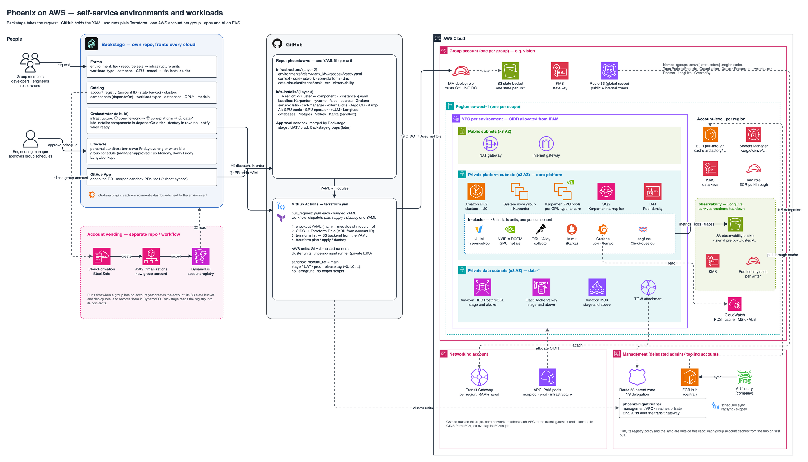

# infrastructure

Self-service AWS environments for the **Phoenix** platform. Developers,
engineers and researchers ask for an environment in **Backstage**; Backstage
writes one YAML file per unit into this repo and calls **GitHub Actions**, which
runs plain **Terraform** against the group's AWS account. No Terragrunt, no
helper scripts.



Design: [`docs/superpowers/specs/2026-10-23-backstage-driven-terraform-design.md`](docs/superpowers/specs/2026-10-23-backstage-driven-terraform-design.md)

## How it works

1. A person in a **group** (every account belongs to one group) fills in a
   Backstage form. If the group has no account yet, Backstage first runs the
   account-vending workflow (StackSets, separate repo), which records the new
   account, its state bucket and its deploy role in DynamoDB.
2. Backstage opens a PR adding one YAML file per unit, with the environment's
   constants (organisation, group, account ID, state bucket) read from DynamoDB.
3. The PR plans each changed YAML. Sandbox PRs are merged by Backstage itself;
   stage, UAT and prod approvals come with the Backstage group definitions.
4. Backstage dispatches `apply` for each unit **in dependency order**, waits for
   each run, and stops the chain on a failure. Teardown — Friday evening, idle,
   or on request — is `destroy` in reverse order. `LongLive: true` keeps a unit.

| Kind | Example | Lifetime (owned by Backstage) |
|---|---|---|
| Personal sandbox | one researcher, isolated (`requester` set) | destroyed Friday evening or when idle |
| Group, scheduled | a team's Mon–Fri environment, schedule approved by its engineering manager | up/down on the schedule |
| Group, always on | shared group environment | `LongLive: true`, kept |
| Stage / UAT / prod | promotion targets | kept |

## Layout

```text
environments/<tier>/<env_id>/<scope>/<resource-set>.yaml   one unit per file, written by Backstage
modules/<resource-set>/                                    one plain Terraform root per resource set
modules/context/                                           shared: identity, naming, tags, state, network lookup
modules/credentials/                                       shared library: passwords and secrets
../.github/workflows/terraform.yml (repo root AWS/)          the only pipeline, shared with k8s-installs
docs/                                                      design, plan, architecture diagram
```

- `tier`: `sandbox`, `stage`, `uat` or `prod`.
- `env_id`: `<group>-<environment>[-<requester>]` — the environment's unique
  key, e.g. `research-sandbox-jdoe`. Path, state key and resource names all start
  with it, so two researchers in one group never collide.
- `scope`: the AWS region, or `global` (dns only).

## A unit's YAML

```yaml
# environments/sandbox/research-sandbox-jdoe/eu-west-1/core-platform.yaml
organisation: acme                 # from DynamoDB / Backstage constants
group: research
environment: sandbox
requester: jdoe                    # standalone requests only
tier: sandbox
region: eu-west-1                  # omitted for global scope
account_id: "111111111111"         # the only account reference needed
module_ref: main                   # sandbox: main; stage/UAT/prod: a release tag
state:
  bucket: acme-tfstate-111111111111
  region: eu-west-1
tags:                              # owner.team and Reason required
  owner.team: research
  Reason: model evaluation
  LongLive: false                  # absent or false = ephemeral
spec:                              # the resource set's own settings
  clusters:
    "1": { ... }
```

**Roles are known by name; only account IDs vary.** Every account's deploy role
is `Terraform-Role` (created by account vending). The workflow assumes
`arn:aws:iam::<account_id>:role/Terraform-Role`; cross-account references in
`spec` are just account IDs (`spec.providers.management.account_id`,
`spec.providers.network.account_id`). Backstage only ever passes account IDs.

## Resource sets

| Resource set | What it builds | Notes |
|---|---|---|
| `core-network` | VPCs (CIDR from IPAM), subnets, NAT, endpoints, optional TGW | IPAM only — no literal CIDRs |
| `core-platform` | EKS clusters, system node group, addons, Karpenter IAM, observability bindings | GPU capacity comes from Karpenter pools in k8s-installs |
| `data-rds` | RDS PostgreSQL/MySQL | `eks_clusters` required with several clusters |
| `data-elasticache` | ElastiCache (Valkey/Redis) | 40-character ID limit checked at plan |
| `data-msk` | MSK (Kafka), IAM auth, optional SCRAM | |
| `dns` | Route 53 public/internal zone pairs, delegated from the management account | global scope only |
| `observability` | Long-lived S3 history + Pod Identity roles for each cluster's Grafana stack and Langfuse | account-level, `LongLive: true` required |
| `ecr` | Pull-through cache from the central ECR hub (fed from Artifactory) | account-level |

Account-level sets (`observability`, `ecr`) live in the group's `shared`
environment: `environments/<tier>/<group>-shared/<region>/`.

Each module's README has its full `spec`.

## Order (Backstage runs units by this)

```text
observability ──┐
core-network ───┴──► core-platform ──► data-rds / data-elasticache / data-msk
dns, ecr: independent
```

Apply in this order, destroy in reverse. A unit planned before its dependency
has state fails with a clear message; a unit destroyed after its dependency is
gone still plans.

## The workflow

`.github/workflows/terraform.yml` at the repo root (`AWS/`), shared with
`k8s-installs`. Unit paths are given from the repo root
(`infrastructure/environments/...`):

| Trigger | What runs |
|---|---|
| `workflow_dispatch` (Backstage) — `config_file` (from the repo root), `action` = `plan` \| `apply` \| `destroy` | that one unit; `apply`/`destroy` only from `main` |
| `pull_request` changing `infrastructure/environments/**.yaml` | `plan` of every changed unit, summarised in the job summary |
| `pull_request` changing `infrastructure/modules/**` | `terraform test` of every changed module (mock providers, no AWS) |

Per unit it checks that the path matches the YAML (tier, env_id, region),
checks out the modules at `module_ref`, assumes the account's
`Terraform-Role` over GitHub OIDC, runs `terraform init` with the S3 backend
from the YAML (key `<env_id>/<scope>/<resource-set>/terraform.tfstate`,
lockfile, encryption) and runs the action. One run per unit at a time
(`concurrency`). Removing a unit is a `destroy` Backstage dispatches before it
deletes the YAML.

## Naming and tags

- Names: `<env_id>-<region code>` (`research-sandbox-jdoe-euw1`); global scope
  drops the region code. Region codes live in `modules/context`.
- Tags on everything: `Project=Phoenix`, `Organisation`, `Group`, `Requester`
  (when set), `Environment`, `Tier`, `Scope`, `Region`, `ResourceSet`,
  `ManagedBy`, plus the YAML `tags`. A plan fails without `owner.team` and
  `Reason`, or with a non-boolean `LongLive`.

## Observability

Each EKS cluster runs its own Grafana stack (Grafana, Mimir, Loki, Tempo,
OTel/Alloy, NVIDIA DCGM) and Langfuse, deployed from the in-cluster repo. This
repo provides the AWS side: the group's long-lived `observability` bucket
(history survives weekend teardowns), per-signal Pod Identity roles scoped to
each cluster's own prefix, and the bindings in `core-platform`. See
[`modules/observability`](modules/observability/README.md).

## Container images

Group accounts pull through their own ECR from a central ECR hub, which a
scheduled sync fills from the company's Artifactory (ECR's pull-through cache
cannot use Artifactory directly). The hub and the sync live outside this repo.
See [`modules/ecr`](modules/ecr/README.md).

## Lives elsewhere

- Account vending, state buckets, `Terraform-Role` in every account (StackSets).
- Backstage: forms, constants, ordering, schedules, idle detection, approvals.
- The central ECR hub and the Artifactory sync.
- Everything inside the clusters: [`../k8s-installs`](../k8s-installs/README.md) (Grafana stack, vLLM, Langfuse, GPU operator, ...).
- Networking foundations: IPAM pools, transit gateways (to be redesigned).

## Running locally

Terraform ≥ 1.15. With credentials for the target account:

```bash
cd modules/core-platform
terraform init \
  -backend-config="bucket=acme-tfstate-111111111111" \
  -backend-config="key=research-sandbox-jdoe/eu-west-1/core-platform/terraform.tfstate" \
  -backend-config="region=eu-west-1" -backend-config="encrypt=true" -backend-config="use_lockfile=true"
terraform plan -var config_file=/path/to/core-platform.yaml   # a unit YAML in the format above
```

## Tests

Every resource set has `terraform test` suites against mock providers — no AWS
access needed:

```bash
cd modules/<resource-set> && terraform init -backend=false && terraform test
```

## Adding a resource set

1. `modules/<name>/` with the four standard files copied from an existing
   module — `_context.tf` (change `resource_set`, and `network = true` if it
   sits in a VPC), `providers.tf`, `backend.tf`, `versions.tf` — plus its
   resources reading `module.context.spec`.
2. `tests/<name>.tftest.hcl` with fixtures; the workflow tests it on every PR.
3. Its place in the order above, for Backstage.
4. A `README.md` saying what it creates and its `spec`, then a **Running it**
   section like every other module's: what must exist first, the unit file and
   state key, how to run it, its outputs (every output has a `description`),
   and what to destroy before it.
