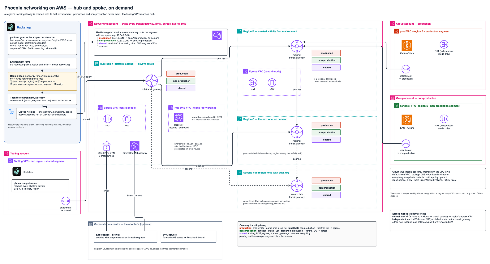

# networking

Layer 1 of Phoenix on AWS: the network every environment sits on. One hub
region (two for dual Direct Connect), and a transit gateway in every other
region from the moment its first environment is requested, peered with every
region that already has one. Production and non-production never reach each
other by any AWS path; the tooling VPC reaches both.



Same conventions as [`../infrastructure`](../infrastructure/README.md): plain
Terraform roots in `modules/<unit>`, one YAML per unit written by Backstage,
`infrastructure/modules/context`, the one GitHub workflow, `terraform test`
with mock providers.

## Units

All run in the networking account, as one environment: `group: platform`,
`environment: network`, `tier: prod` (names `platform-network-<region code>-…`).

| Unit | YAML | Creates |
|---|---|---|
| `ipam` | `global/ipam.yaml` | IPAM, a pool per segment, a regional pool per segment per joined region, RAM shares |
| `region` | `<region>/region.yaml` | transit gateway, its three route tables and blackholes; central egress: the egress VPC |
| `peering` | `<region>/peering.<peer>.yaml` | peering attachment and the static routes on both sides |
| `hub` | `<region>/hub.yaml` | DNS VPC with Route 53 Resolver endpoints (inbound in hub regions) and the region's forwarding rules, shared through RAM; in every region when `dns_forwarding` is set |
| `hybrid` | `<first hub>/hybrid.yaml` | VPN and/or Direct Connect to on-prem |

A new region is applied in that order: `ipam` (the region added to
`regions`), `region`, then one `peering` per region that already has a
transit gateway. Then the environment's own units (core-network first).

## Platform settings

Backstage copies the adopter's decisions (`phoenix/platform.yaml` in the
Backstage repository) into `spec.network` of every unit that needs them;
`modules/context` validates them and derives the segments
(`platform_network` output). Terraform never reads the settings file itself.

## State

One bucket in the networking account; keys follow context
(`platform-network/<scope>/<unit>[.<instance>]/terraform.tfstate`):

| Unit | Key |
|---|---|
| ipam | `platform-network/global/ipam/terraform.tfstate` |
| region | `platform-network/<region>/region/terraform.tfstate` |
| peering | `platform-network/<region>/peering.<peer>/terraform.tfstate` |
| hub | `platform-network/<region>/hub/terraform.tfstate` |
| hybrid | `platform-network/<first hub>/hybrid/terraform.tfstate` |

Units read each other's outputs from these keys, and core-network reads the
`region` unit's.

## Runbooks

### First-time setup (once, by the adopter)

1. From the organisation's **management account**, delegate IPAM
   administration to the networking account and let RAM share inside the
   organisation:

   ```sh
   aws ec2 enable-ipam-organization-admin-account --delegated-admin-account-id <networking account id>
   aws ram enable-sharing-with-aws-organization
   ```

2. Write `phoenix/platform.yaml` in the Backstage repository (the settings
   table in the networking design: hub regions, address space, egress mode,
   hybrid, on-prem ranges, DNS forwarding, `share_with`). `address_space` and
   the netmasks cannot change after step 3.
3. Apply, in order, each through the workflow (`action: apply`):
   1. `global/ipam.yaml`, with `regions: [<first hub>]` and
      `global_region: <first hub>` (IPAM's home region, which never moves);
   2. `<first hub>/region.yaml`;
   3. `<first hub>/hub.yaml`, when `hybrid` or `dns_forwarding` is set;
   4. `<first hub>/hybrid.yaml`, when `hybrid` is not `none`;
   5. with two hubs: the second hub's `region.yaml`, its
      `peering.<first hub>.yaml` and its `hub.yaml`, then `hybrid` again
      (`dual_dx` associates the second hub);
   6. the tooling VPC: a core-network unit in the tooling account, first hub
      region, with `segment: shared` on its VPC.
4. Hand the on-prem team `terraform output onprem` from `hybrid` and
   `inbound_endpoint_ips` from `hub`.

### Adding a region (what Backstage does; by hand only if it cannot)

For a region `<new>` with no transit gateway yet:

1. `global/ipam.yaml`: append `<new>` to `regions` (never remove one); apply.
2. `<new>/region.yaml`; apply.
3. `<new>/peering.<peer>.yaml` for every region that already has a transit
   gateway, hubs included; apply each.
4. With `dns_forwarding` set: `<new>/hub.yaml` (the region's outbound
   Resolver endpoint and rules); apply.
5. Then the environment's own units, core-network first.

A region is never taken away: its transit gateway, pools and peerings are
`prevent_destroy`.

### Losing the first hub's region (two hubs)

Losing a Direct Connect connection under `dual_dx` fails over by itself (BGP,
inside the one Direct Connect gateway). Losing the first hub's **region** does
not: the tooling VPC (Backstage and its runner), every region's routes to the
tooling VPC and to on-prem, and the on-prem attachment all live there. That
failover is manual:

1. In `platform.yaml`, swap the order of `hub_regions` (the second hub becomes
   the first). Backstage rewrites `spec.network` in every unit.
2. Re-apply every `peering` unit: the hub routes move to the peerings with the
   new first hub.
3. Bring tooling up in the new first hub (a core-network unit with
   `segment: shared` there), and re-point anything that reached the old one.
4. Write and apply `hybrid` in the new first hub: the Direct Connect gateway
   (or VPN) is associated with the new first hub's transit gateway. With
   `dual_dx` the virtual interfaces stay; only the association moves.

IPAM's home region cannot move (`global_region` stays the old first hub).
Its regional pools serve their own regions; check that new VPC allocations
still succeed while the home region is impaired before relying on it.
